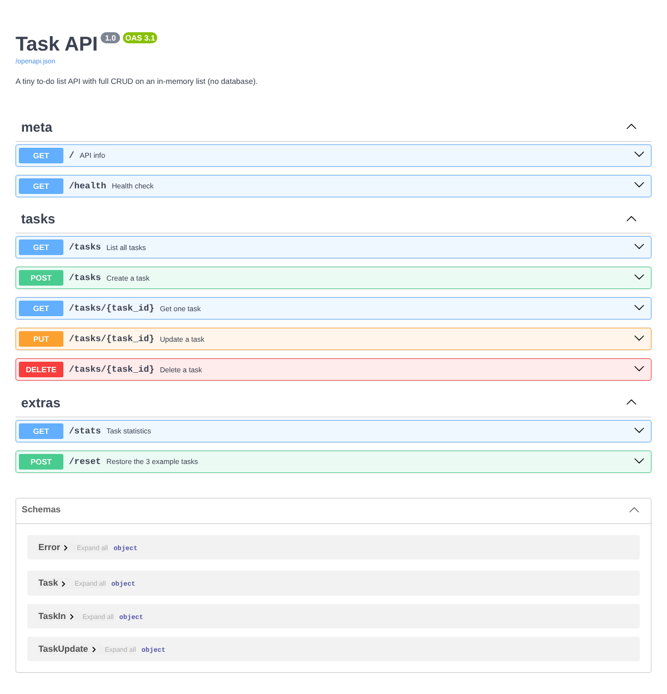
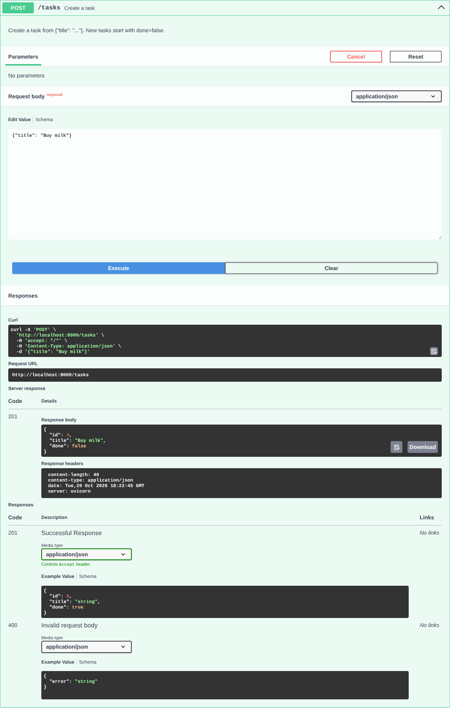

# Task API

A small to-do list API built with **Python + FastAPI** for FlyRank Backend Track, Week 2, Assignment A1.
It supports full CRUD (Create, Read, Update, Delete) on tasks. Data lives **in memory only** (no database, no files), so it resets whenever the server restarts.

## Run it

Needs Python 3.10+.

```bash
pip install -r requirements.txt
uvicorn main:app --reload
```

The server starts at <http://localhost:8000>. Interactive docs (Swagger UI) are at <http://localhost:8000/docs>.

## Endpoints

| Method | Path | What it does | Success | Errors |
|--------|------|--------------|---------|--------|
| GET | `/` | API info | 200 | |
| GET | `/health` | Health check | 200 | |
| GET | `/tasks` | List all tasks (optional `?done=true` and `?search=milk`) | 200 | 400 bad filter |
| GET | `/tasks/{id}` | Get one task | 200 | 404 unknown id |
| POST | `/tasks` | Create a task from `{"title": "..."}` | 201 | 400 missing/empty title |
| PUT | `/tasks/{id}` | Update `title` and/or `done` | 200 | 400 empty/invalid body, 404 unknown id |
| DELETE | `/tasks/{id}` | Delete a task (empty body) | 204 | 404 unknown id |
| GET | `/stats` | `{"total", "done", "open"}` counts (extra) | 200 | |
| POST | `/reset` | Restore the 3 example tasks (extra) | 200 | |

Every error returns JSON like `{"error": "Task 99 not found"}`. Bad request bodies return **400** (FastAPI's default 422 is replaced with a custom handler to match the assignment).

A task looks like `{"id": 1, "title": "Learn HTTP", "done": true}`.

## Example: `curl -i`

```console
$ curl -i -X POST http://localhost:8000/tasks -H "Content-Type: application/json" -d '{"title":"Buy milk"}'
HTTP/1.1 201 Created
date: Tue, 20 Oct 2026 18:22:31 GMT
server: uvicorn
content-length: 40
content-type: application/json

{"id":4,"title":"Buy milk","done":false}
```

More checks you can run:

```bash
curl -i http://localhost:8000/tasks/1                 # 200 + one task
curl -i http://localhost:8000/tasks/99                # 404 + {"error": "Task 99 not found"}
curl -i -X POST http://localhost:8000/tasks -H "Content-Type: application/json" -d '{}'   # 400
curl -i -X PUT http://localhost:8000/tasks/2 -H "Content-Type: application/json" -d '{"done":true}'  # 200
curl -i -X DELETE http://localhost:8000/tasks/2       # 204, empty body
```

## Swagger UI

All endpoints are listed at `/docs`, and "Try it out" works for the whole CRUD cycle.



Creating a task through "Try it out" (returns 201):



## Extras

- **Filtering:** `GET /tasks?done=true` returns only finished tasks.
- **Search:** `GET /tasks?search=milk` returns tasks whose title contains the word (case-insensitive).
- **Stats:** `GET /stats` returns `{"total": 4, "done": 1, "open": 3}`.
- **Reset:** `POST /reset` restores the 3 example tasks.

### The mortality experiment

I created a task ("Task made before restart"), confirmed it appeared in `GET /tasks`, restarted the server, and called `GET /tasks` again: the task was gone and only the 3 original example tasks remained. The tasks are stored in a Python list that exists only in the running process's memory, so when the process stops the memory is freed and the list is rebuilt from the code on the next start. That is exactly why a database is needed.

## Project layout

```
main.py            the whole API (~175 lines, including docs and extras)
requirements.txt   dependencies
docs/              Swagger screenshots
```
